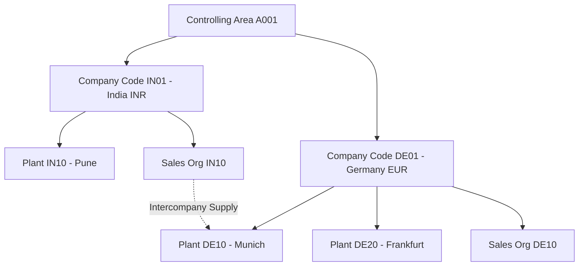

# Reference Enterprise Structure: Apex Industrial Systems (Illustrative)

> **Illustrative Model Notice:** All company codes, plants, and IDs below are fictional reference values designed to unify scenarios across this hub.

## 1. Organizational Design Overview
Apex Industrial Systems operates two legal entities under a single Controlling Area (`A001`) and Operating Chart of Accounts (`YCOA`):
- **Company Code `IN01` (Apex India Pvt. Ltd., INR):** Primary selling entity for APAC customers and domestic assembly (`Plant IN10`).
- **Company Code `DE01` (Apex Germany GmbH, EUR):** Primary precision manufacturing hub (`Plant DE10`) and European distribution center (`Plant DE20`).

## 2. Core Architectural Rules ("Why" It Works This Way)
- **Why can a Plant only be assigned to ONE Company Code?** Because inventory valuation is performed at the **Plant (Valuation Area)** level. Assigning one plant to two legal entities would break legal inventory ownership and financial balance-sheet valuation in `ACDOCA`.
- **Why can a Sales Organization only be assigned to ONE Company Code?** Because the Sales Organization represents the legally responsible selling entity on the customer contract/invoice and deterministically derives the single Company Code for FI-AR revenue postings.

## 3. Assignment Matrix
| Org Object | Code | Assigned To | Business Role |
| :--- | :--- | :--- | :--- |
| **Controlling Area** | `A001` | CoCodes `IN01`, `DE01` | Cross-company-code cost & margin analysis |
| **Company Code** | `IN01` | Country `IN` (INR) | Indian selling & assembly entity |
| **Company Code** | `DE01` | Country `DE` (EUR) | German manufacturing & export entity |
| **Plant** | `IN10` | CoCode `IN01` | Pune Assembly Plant |
| **Plant** | `DE10` | CoCode `DE01` | Munich Manufacturing Plant |
| **Plant** | `DE20` | CoCode `DE01` | Frankfurt Distribution Plant |
| **Sales Org** | `IN10` | CoCode `IN01` | India Domestic & APAC Sales |
| **Sales Org** | `DE10` | CoCode `DE01` | Europe & Intercompany Export Sales |
| **Purchasing Org** | `P001` | Plants `IN10`, `DE10`, `DE20` | Cross-company central purchasing |

## 4. Enterprise Hierarchy Diagram

