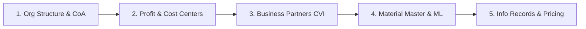

# Master Data Dependency Matrix

> **Illustrative Reference:** Built on [Apex Industrial Systems](../../01-ENTERPRISE-STRUCTURE/examples/manufacturing-enterprise.md).

## 1. Object Dependency Matrix
| Master Data Object | Core Table(s) | Required Org Levels | Mandatory Roles / Views | Downstream Process Impact |
| :--- | :--- | :--- | :--- | :--- |
| **Business Partner (Customer)** | `BUT000`, `KNA1`, `KNB1`, `KNVV` | Client, CoCode (`IN01`), Sales Area (`IN10/10/00`) | `000000`, `FLCU00` (FI), `FLCU01` (SD), `UKM000` (Credit) | Sales Order partner determination, FI-AR reconciliation, Credit Management |
| **Business Partner (Supplier)** | `BUT000`, `LFA1`, `LFB1`, `LFM1` | Client, CoCode (`IN01`), Purch Org (`P001`) | `000000`, `FLVN00` (FI), `FLVN01` (MM) | Purchase Orders, Intercompany AP, MIRO Invoice Verification |
| **Material / Product Master** | `MARA`, `MARC`, `MVKE`, `MBEW` | Client, Plant (`DE10`), Sales Org (`IN10`) | Basic, Sales (Item Cat Grp), Purchasing, MRP, Accounting (Val Class) | Item category (`VOV4`), aATP check, `OBYC`/`VKOA` account determination |
| **Pricing Condition Records** | `Axxx`, `KONH`, `KONP` | Sales Org, Dist Channel, Customer/Material | Condition Types (`PR00`, `PI01`/`IV01`) | Order pricing (`PRCD_ELEMENTS`) and Intercompany billing |
| **Financial Master Data** | `SKA1`, `SKB1`, `CSKS`, `CEPC` | Chart of Accounts (`YCOA`), CoCode, Controlling Area (`A001`) | GL Accounts, Cost Centers, Profit Centers | Universal Journal (`ACDOCA`) real-time postings |

## 2. Master Data Load Sequence (Migration Prerequisite)

