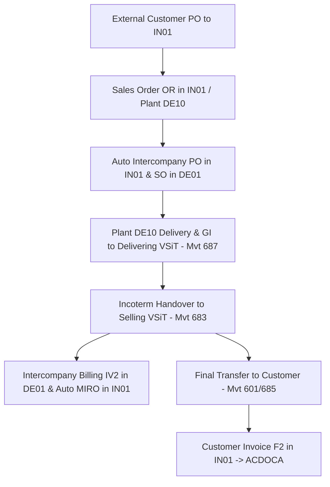

# Intercompany Order-to-Cash (`PROC-O2C-IC-001`)

> **Verification Status:** `draft` — Illustrative cross-functional vertical slice using [Apex Industrial Systems](../../../01-ENTERPRISE-STRUCTURE/examples/manufacturing-enterprise.md) (`IN01` selling to external customer; `DE01` Plant `DE10` manufacturing and shipping).

## 1. Business Context
An Indian customer places an order with **Apex India (`IN01`, Sales Org `IN10`)**, which fulfills the order directly from **Apex Germany's Munich Plant (`DE10`, Company Code `DE01`)**.

## 2. Prerequisites & Linked Knowledge
- Enterprise Structure: [ENT-MFG-REF-001](../../../01-ENTERPRISE-STRUCTURE/examples/manufacturing-enterprise.md)
- Master Data: [MD-GOV-MAT-001](../../../02-MASTER-DATA/master-data-governance/master-data-dependency-matrix.md)

## 3. Conceptual Process Flow
See [`process-flow.mmd`](process-flow.mmd) for the Mermaid diagram:

## 4. Key S/4HANA (`5D2`) vs. ECC Classic Intercompany Differences
- **Classic ECC:** Relied on Sales Order (`OR`) -> Delivery (`LF`, Mvt `601`) -> Intercompany Billing (`IV`) with no purchasing document in the selling company code and no Valuated Stock in Transit (`VSiT`).
- **S/4HANA Advanced Intercompany (`5D2`):** Orchestrates a full value chain via Fiori **Monitor Value Chains (`F4854`)**, using **Movement Type `687`** (Delivering VSiT) and **Movement Type `683`** (Title transfer to Selling VSiT) for IFRS-15 revenue cutoff compliance.

## 5. Scenario Modules
- [`process-flow.mmd`](process-flow.mmd) — Standalone Mermaid diagram source.
- [`configuration.md`](configuration.md) — Illustrative SPRO configuration overview.
- [`accounting-impact.md`](accounting-impact.md) — Conceptual Dr/Cr journal entry flow across `DE01` and `IN01`.
